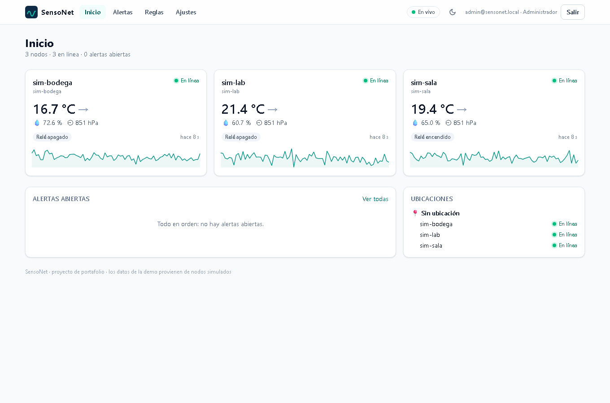
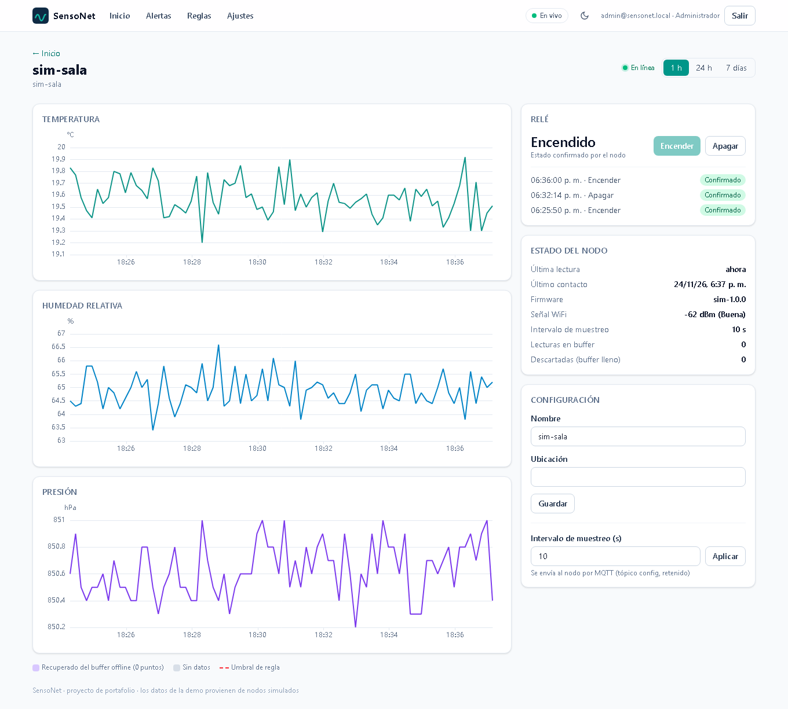
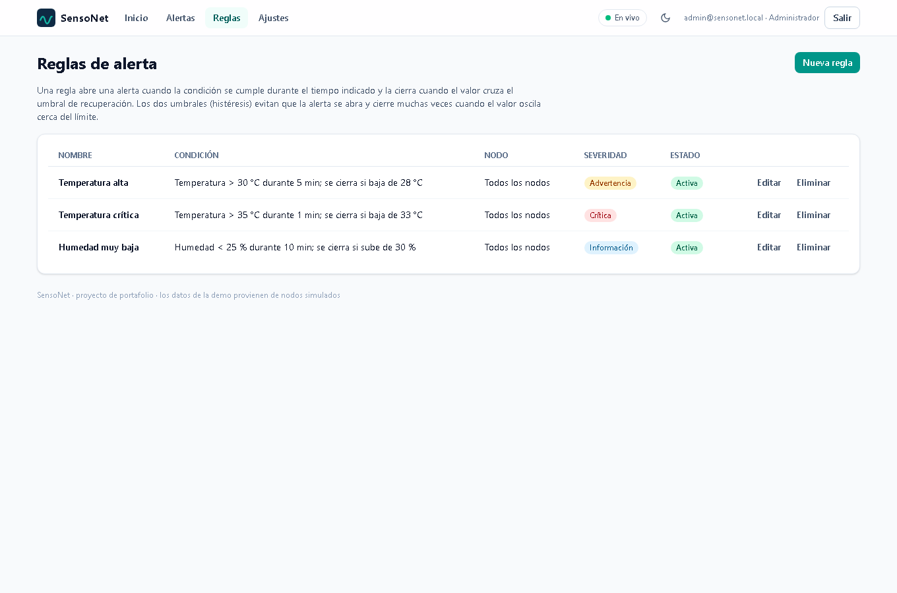
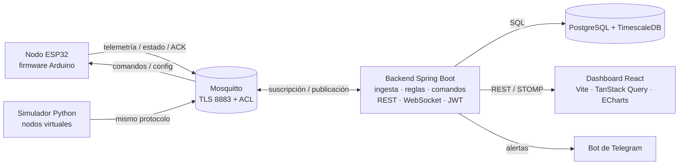

# SensoNet

**Monitor IoT en tiempo real** con ESP32, MQTT (TLS), Spring Boot, PostgreSQL + TimescaleDB y React.

Los nodos miden temperatura, humedad y presión. Envían las lecturas por MQTT con TLS a un backend que las valida, descarta duplicados, las guarda como serie de tiempo y evalúa reglas de alerta con histéresis. Un dashboard en React se actualiza al instante por WebSocket. Desde el dashboard se enciende o apaga un relé en el nodo con confirmación, y las alertas llegan a Telegram.

> **Estado del hardware:** el firmware del ESP32 ([firmware/](firmware/)) **compila** para ESP32 en Arduino IDE / `arduino-cli`, y su lógica pura tiene pruebas nativas, pero **no se ha probado en un nodo físico**. Toda la demo funciona con el [simulador de nodos](simulator/), que habla exactamente el mismo protocolo (tópicos, esquema JSON, LWT, comandos y buffer offline).



| Detalle del nodo | Reglas con vista previa |
|---|---|
|  |  |

## Qué hace

- **Ingesta MQTT segura**: Mosquitto solo acepta TLS (puerto 8883), con usuario por nodo y una ACL en la que cada nodo solo puede publicar en sus propios tópicos.
- **Offline-first**: si se cae el WiFi, el nodo sigue midiendo y guarda las lecturas en una cola circular persistente (2.000 lecturas ≈ 5,5 h). Al reconectar las reenvía en lotes. El backend descarta duplicados por `(nodo, ts, seq)`, así que reenviar nunca duplica datos.
- **Serie de tiempo**: hypertable de TimescaleDB, agregado continuo por hora y retención de 30 días del detalle. También funciona con PostgreSQL simple (ADR 0004).
- **Motor de reglas** puro y probado: umbral, duración mínima e **histéresis** (p. ej. abre con > 30 °C durante 5 min y cierra al bajar de 28 °C). Incluye una **vista previa sobre el histórico**: «esta regla se habría disparado 3 veces ayer».
- **Comandos con confirmación**: `PENDING → CONFIRMED`, o `FAILED` si no llega el ACK en 10 s. Son idempotentes por id.
- **Tiempo real**: WebSocket/STOMP autenticado con JWT. Las gráficas muestran los tramos **sin datos** y los **recuperados del buffer** offline.
- **API REST** documentada con OpenAPI (Swagger UI), errores en formato **ProblemDetail (RFC 9457)**, JWT con roles `ADMIN` / `VIEWER` y límite de peticiones por IP.
- **Alertas por Telegram**, con límite de frecuencia por regla y nodo.

## Arquitectura



El broker desacopla los nodos del backend: los nodos no conocen el backend y el backend no necesita saber cuántos nodos hay. Más detalle en [docs/ARQUITECTURA.md](docs/ARQUITECTURA.md).

## Cómo correrlo

Requisitos: Docker con Docker Compose.

```bash
cp .env.example .env        # cambia las contraseñas
docker compose --profile demo up --build
```

| Servicio | URL |
|---|---|
| Dashboard | http://localhost:5173 (usuario y clave: `SENSONET_ADMIN_*` de `.env`) |
| Swagger UI | http://localhost:8080/swagger-ui.html |
| Broker MQTT (TLS) | `localhost:8883`, CA en `infra/certs/generated/ca.crt` |

Si algún puerto ya está ocupado, cámbialo con `BACKEND_PORT` / `FRONTEND_PORT` en `.env`. Sin `--profile demo` el sistema se levanta sin el simulador, a la espera de nodos reales.

Escenarios del simulador (variable `SIM_ESCENARIO` en `.env`). Cada escenario afecta al primer nodo de la lista; los demás siguen normales para comparar.

| Escenario | Qué muestra |
|---|---|
| `normal` | Ciclo diario de temperatura con ruido realista |
| `ola-de-calor` | Supera 30 °C más de 5 min (alerta de advertencia), luego 36 °C (alerta crítica), y se recupera |
| `corte-wifi` | Pierde la conexión (el broker publica el LWT `offline`), sigue midiendo y al volver reenvía el buffer |

## Pruebas

| Nivel | Herramienta | Cantidad |
|---|---|---|
| Unitarias backend (motor de reglas, validación, comandos, notificaciones) | JUnit 5 + AssertJ + Mockito | 31 |
| Integración backend (TimescaleDB, PostgreSQL y Mosquitto reales) | Testcontainers + MockMvc | 21 |
| Cobertura de líneas del backend (servicios y reglas ≥ 70 % exigido en CI) | JaCoCo | 86,7 % total |
| Frontend (series, formato, componentes, login) | Vitest + Testing Library | 15 |
| Simulador (buffer, entorno físico, relé idempotente) | pytest | 10 |
| Firmware, lógica pura en el PC (buffer circular, JSON, validación) | g++ | 11 pruebas / 240 comprobaciones |
| Firmware, compilación para ESP32 (BME280 y SHT31) | arduino-cli | 2 variantes |
| Extremo a extremo (simulador → broker → backend → dashboard) | Playwright + Docker Compose | 5 |

Casos clave cubiertos: una lectura duplicada se guarda una sola vez; una humedad de 140 % se rechaza y queda registrada; la regla «> 30 °C por 5 min» no abre con 4 min 59 s y sí con 5 min; valores que oscilan entre 29,5 y 30,5 °C no abren y cierran la alerta repetidamente; un comando sin ACK en 10 s queda `FAILED`; un `VIEWER` recibe 403 al intentar encender el relé; 30 min sin WiFi no pierden lecturas.

```bash
cd backend && mvn verify                       # unitarias + integración + cobertura (requiere Docker)
cd frontend && npm test
cd simulator && pip install -r requirements-dev.txt && pytest
sh firmware/test/run_tests.sh                  # requiere g++
cd e2e && npm ci && npx playwright test        # con el sistema levantado (ver e2e/)
```

## Seguridad

Resumen del [modelo de amenazas](docs/SECURITY.md):

| Amenaza | Mitigación |
|---|---|
| Suplantación de nodo | Usuario y contraseña por nodo; la ACL (`pattern … %u`) limita cada nodo a sus tópicos. Verificado: `sim-lab` no puede publicar como `sim-sala` |
| Escucha de tráfico | MQTT solo con TLS 1.2+ y CA propia; no existe listener sin cifrar |
| Comandos no autorizados | Solo el usuario `backend` puede publicar en `cmd/#`; en la API, JWT y rol `ADMIN` |
| Datos maliciosos | Límite de tamaño (broker y backend), validación de esquema y de rango físico |
| Fuga de secretos | `.env` y `secrets.h` fuera del repo, plantillas `.example`, gitleaks en CI |
| Fuerza bruta / DoS | Límite de intentos de login y de peticiones por IP; límites de conexiones y mensajes en Mosquitto |

## Estructura

```
sensonet/
├─ backend/        Spring Boot 4.2 (Java 25): ingesta MQTT, reglas, API REST, WebSocket
├─ frontend/       React 19 + TypeScript + Vite + Tailwind + ECharts
├─ simulator/      Nodos virtuales en Python (paho-mqtt, MQTT 5)
├─ firmware/       Sketch de Arduino IDE para ESP32 + pruebas nativas
├─ infra/          mosquitto.conf, ACL, generación de usuarios y certificados
├─ e2e/            Pruebas de extremo a extremo con Playwright
├─ docs/           Arquitectura, seguridad, hardware, despliegue y ADRs
└─ .github/        CI: backend, frontend, firmware, simulador, seguridad, e2e
```

## Documentación

- [Arquitectura y protocolo MQTT](docs/ARQUITECTURA.md)
- [Seguridad y modelo de amenazas](docs/SECURITY.md)
- [Hardware de referencia](docs/HARDWARE.md) y [lista de pruebas del nodo físico](docs/PRUEBAS_HARDWARE.md)
- [Despliegue de la demo pública](docs/DESPLIEGUE.md)
- [Decisiones de arquitectura (ADR)](docs/adr/)
- [Firmware](firmware/README.md)

## Licencia

[MIT](LICENSE) · Juan José Román Bedoya
