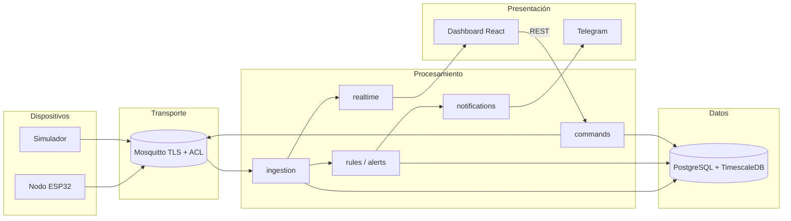
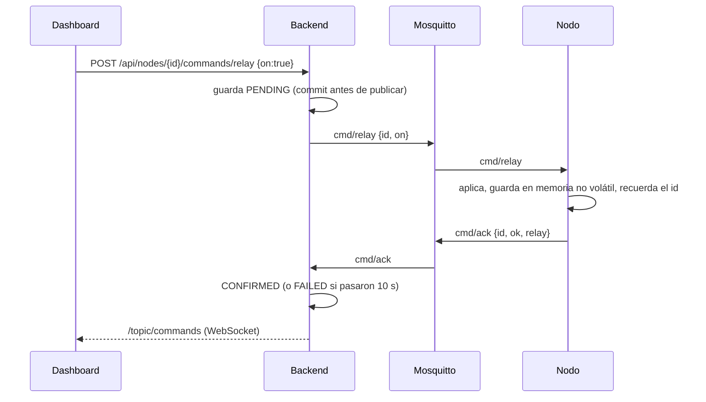

# Arquitectura

SensoNet separa **dispositivos**, **transporte**, **procesamiento** y **presentación**.



## Flujo de una lectura

1. El nodo lee los sensores y arma un JSON con marca de tiempo (NTP o RTC) y número de secuencia.
2. Lo publica en `sensonet/v1/{nodo}/telemetry`. Si no hay conexión, lo guarda en la cola persistente.
3. El backend recibe el mensaje en un hilo dedicado. Comprueba el tamaño, el JSON, el esquema y el rango físico. Si el mensaje es inválido, lo registra en `invalid_readings`.
4. Lo inserta con `ON CONFLICT DO NOTHING`: un duplicado `(nodo, ts, seq)` no se guarda dos veces.
5. Actualiza el estado del nodo y emite la lectura por WebSocket (`/topic/nodes/{id}`). Si llegó con más de 20 s de retraso, va marcada como `backfilled` (venía del buffer).
6. El motor de reglas evalúa la lectura. Si una regla se cumple durante el tiempo configurado, abre una alerta, la emite por WebSocket y notifica por Telegram.

## Protocolo MQTT

| Tópico | Dirección | QoS | Retenido | Contenido |
|---|---|---|---|---|
| `sensonet/v1/{nodo}/telemetry` | nodo → backend | 1* | No | Lectura (JSON v1) |
| `sensonet/v1/{nodo}/status` | nodo → backend | 1 | Sí | `online`/`offline` (LWT), firmware, RSSI, buffer, relé, intervalo |
| `sensonet/v1/{nodo}/cmd/relay` | backend → nodo | 1 | No | `{"id":"<uuid>","on":true}` |
| `sensonet/v1/{nodo}/cmd/ack` | nodo → backend | 1* | No | `{"id":"<uuid>","ok":true,"relay":true}` |
| `sensonet/v1/{nodo}/config` | backend → nodo | 1 | Sí | `{"interval":10}` |

\* El simulador publica con QoS 1. El firmware usa PubSubClient, que solo publica con QoS 0; la forma de compensarlo está en el [ADR 0007](adr/0007-firmware-arduino-ide.md).

Incluir `v1` en el tópico permite cambiar el formato sin romper los nodos antiguos. El **LWT** hace que el broker publique `{"state":"offline"}` si el nodo se desconecta de forma inesperada. Como respaldo, el backend marca offline un nodo sin datos durante más de 3 intervalos.

### Esquema de telemetría v1

```json
{ "v": 1, "seq": 18452, "ts": 1795564800123, "t": 24.61, "h": 58.2, "p": 851.3, "rssi": -61 }
```

| Campo | Significado | Validación |
|---|---|---|
| `v` | versión del esquema | debe ser 1 |
| `seq` | secuencia del nodo | ≥ 0 |
| `ts` | epoch en ms (UTC) | no más de 5 min en el futuro ni de 2 días en el pasado |
| `t` | temperatura °C | −40 a 85 |
| `h` | humedad relativa % | 0 a 100 |
| `p` | presión hPa (opcional; el SHT31 no la mide) | 300 a 1100 (Medellín ≈ 850) |
| `rssi` | señal WiFi dBm (opcional) | −120 a 0 |

### Comandos con confirmación



El nodo ignora los ids repetidos (idempotencia). El comando se confirma en la base de datos **antes** de publicarlo; así un nodo rápido no puede responder antes del commit y que su ACK se descarte.

## Backend: módulos

| Paquete | Responsabilidad |
|---|---|
| `ingestion` | Cliente Paho (TLS, sesión persistente, reconexión), enrutador de tópicos, validación, deduplicación |
| `devices` | Registro de nodos (auto-registro opcional), estado online/offline a partir de `status`/LWT |
| `readings` | Histórico agregado (`raw`, `1m`, `1h`, `1d`) y retención en PostgreSQL simple |
| `rules` / `alerts` | Motor puro con histéresis, estado por (regla, nodo), vista previa sobre el histórico, ciclo de vida de la alerta |
| `commands` | Envío al relé, espera del ACK, tiempo límite |
| `notifications` | Telegram con plantillas y límite de frecuencia |
| `realtime` | STOMP: `/topic/nodes`, `/topic/nodes/{id}`, `/topic/alerts`, `/topic/commands` |
| `security` | JWT (HS256), roles `ADMIN`/`VIEWER`, usuarios, límite de peticiones |

## API REST

| Método | Ruta | Rol |
|---|---|---|
| POST | `/api/auth/login` | público |
| GET | `/api/nodes`, `/api/nodes/{id}` | VIEWER |
| PUT | `/api/nodes/{id}`, `/api/nodes/{id}/config` | ADMIN |
| GET | `/api/nodes/{id}/readings?from&to&bucket` | VIEWER |
| POST | `/api/nodes/{id}/commands/relay` | ADMIN |
| GET | `/api/commands/{id}`, `/api/nodes/{id}/commands` | VIEWER |
| GET / POST / PUT / DELETE | `/api/rules`, `POST /api/rules/preview` | GET: VIEWER; el resto: ADMIN |
| GET | `/api/alerts?status=OPEN\|CLOSED\|ALL` | VIEWER |
| POST | `/api/alerts/{id}/ack` | ADMIN |
| GET / POST / DELETE | `/api/users` | ADMIN |
| GET / POST | `/api/settings/*` | ADMIN |
| GET | `/actuator/health` | público |

La especificación completa está en `/swagger-ui.html`.

## Base de datos

| Tabla | Notas |
|---|---|
| `users` | contraseñas con BCrypt (coste 12) |
| `nodes` | `code` = usuario MQTT; guarda la última lectura para listar rápido |
| `readings` | hypertable por `ts` (chunks de 1 día); PK `(node_id, ts, seq)` |
| `readings_hourly` | agregado continuo en tiempo real (`materialized_only = false`) |
| `invalid_readings` | mensajes rechazados, para auditoría |
| `alert_rules`, `alerts`, `commands` | reglas, ciclo de vida de alertas y comandos |

Volumen esperado: un nodo cada 10 s genera 8.640 lecturas al día (≈ 260.000 al mes). Con 3 nodos son ≈ 780.000 filas al mes.
